# UML and Design Diagrams

All diagrams reflect the implemented system. Each is provided as PNG and SVG in `diagrams/`, with editable Mermaid source in `diagrams/src/` (render at https://mermaid.live or with mermaid-cli).

## 1. Use Case Diagram

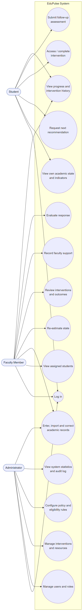

Mermaid source

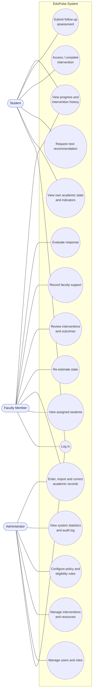

## 2. Class Diagram

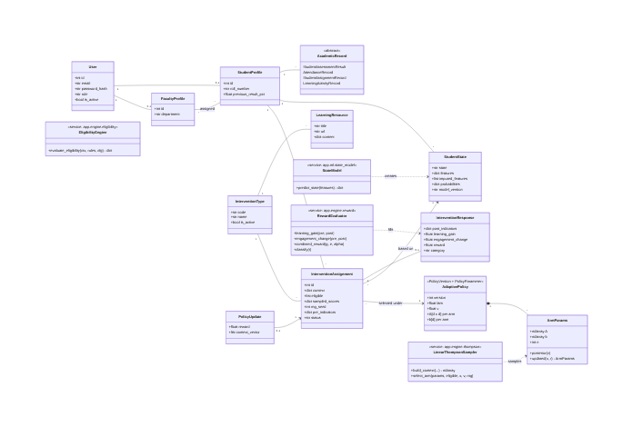

Persistence classes map 1:1 to SQLAlchemy models in `backend/app/models.py`; `AcademicRecord` groups the four record tables. Service classes are the modules in `app/ml` and `app/engine`.

Mermaid source

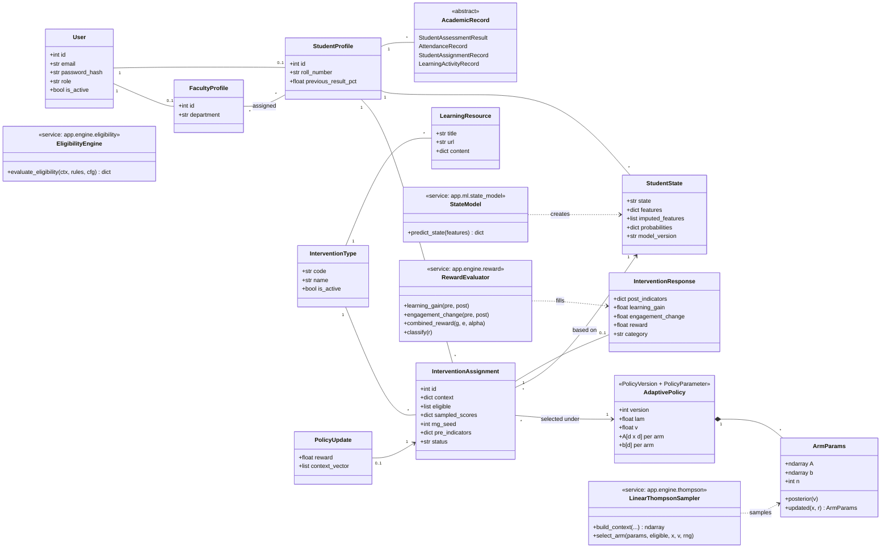

## 3. Sequence Diagram — one complete cycle

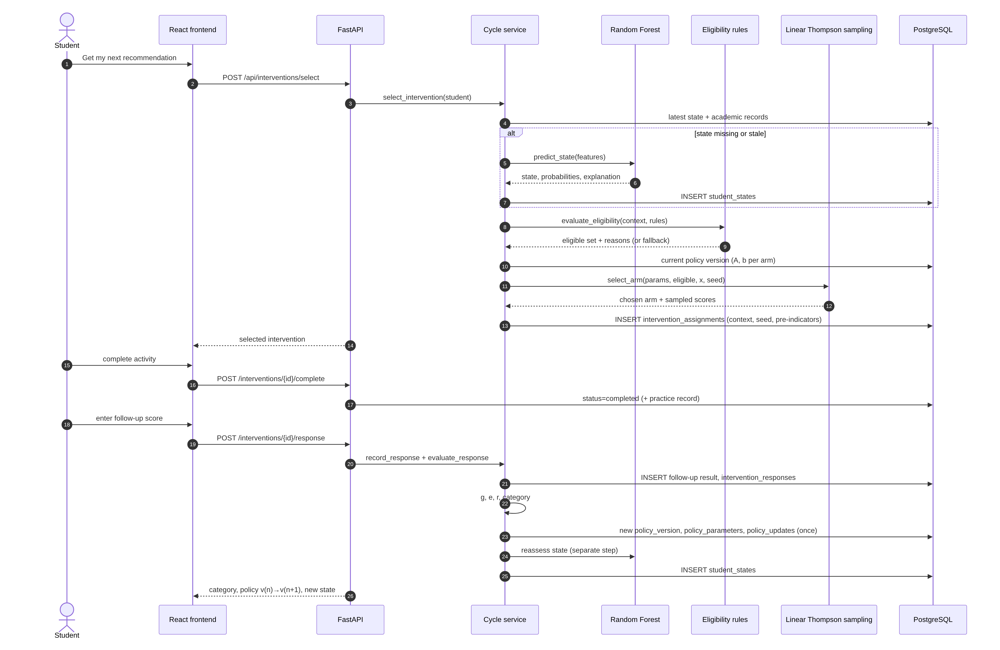

Mermaid source

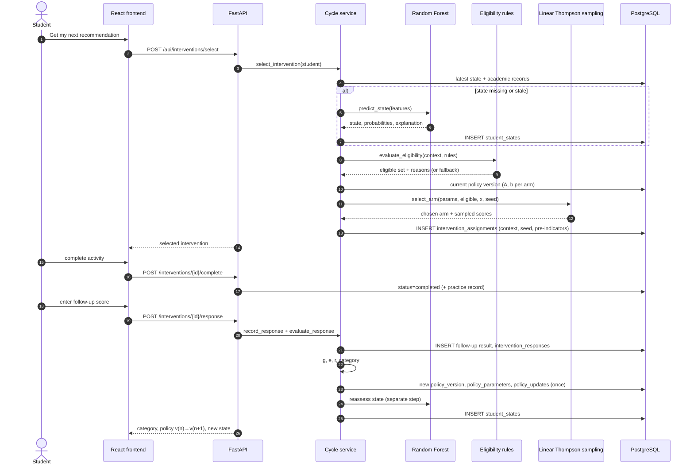

## 4. Activity Diagram — eligibility, fallback and response classification

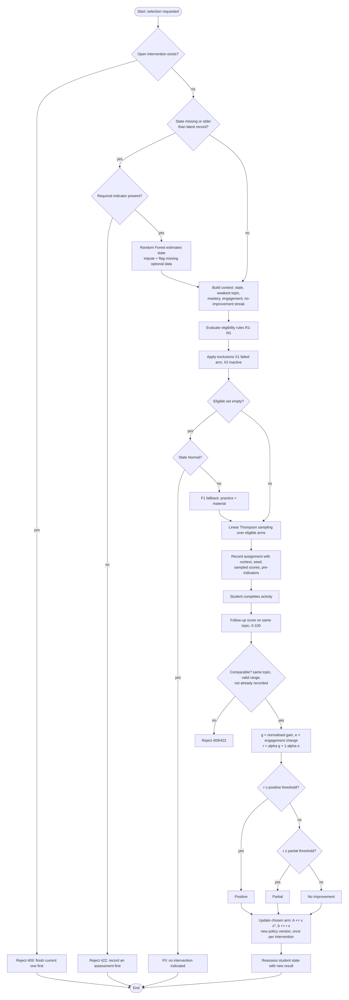

Mermaid source

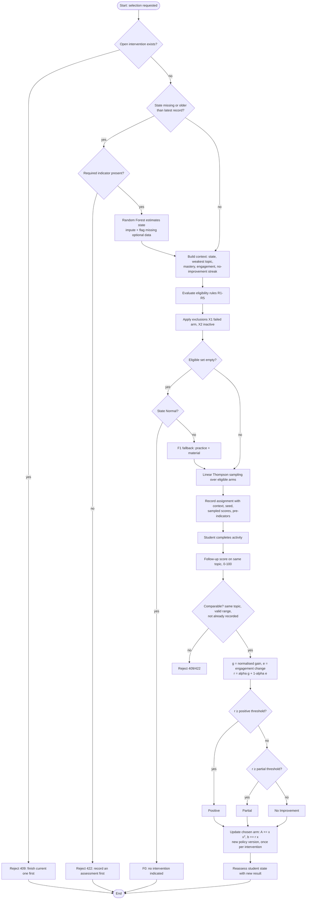

## 5. Component Diagram

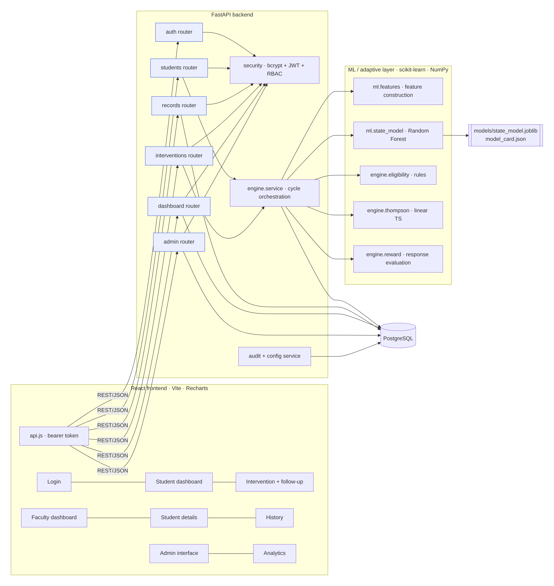

Mermaid source

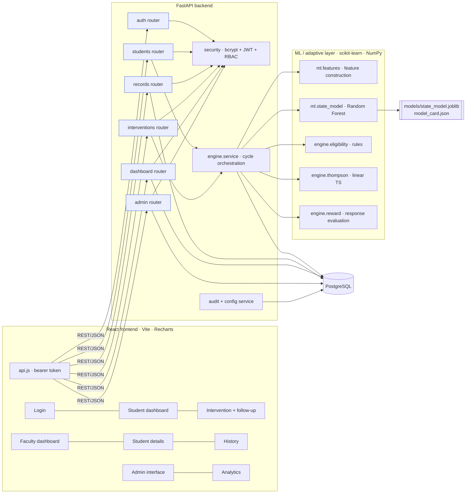

## 6. Deployment Diagram

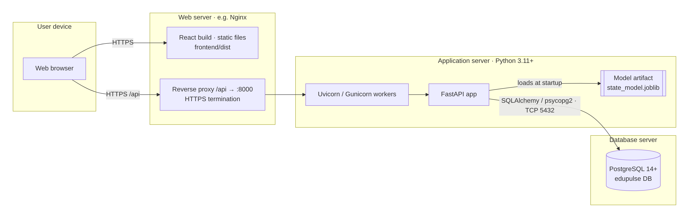

Intended production layout. In development the Vite dev server serves the frontend and proxies `/api` to Uvicorn.

Mermaid source

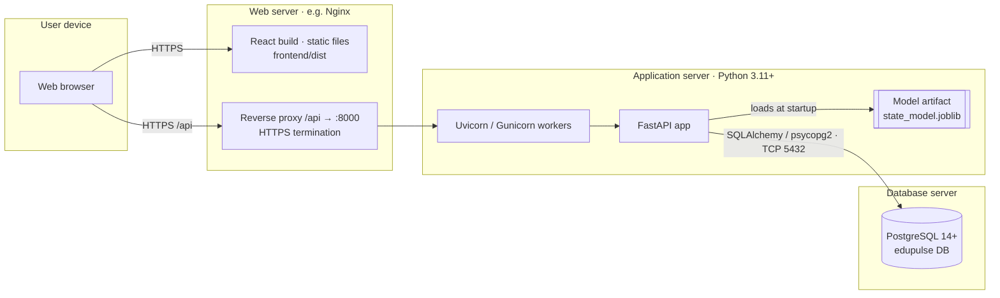

## 7. System Architecture Diagram

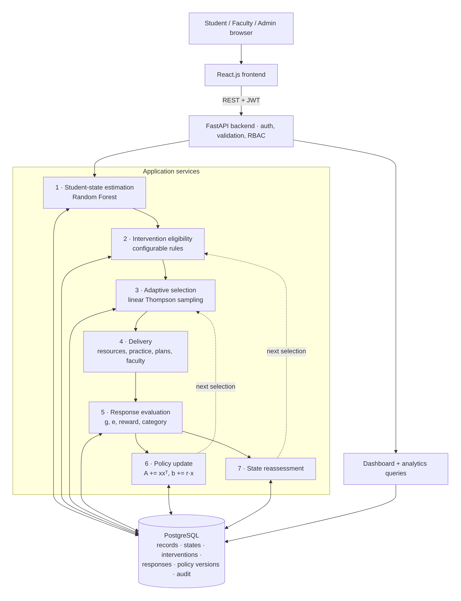

Mermaid source

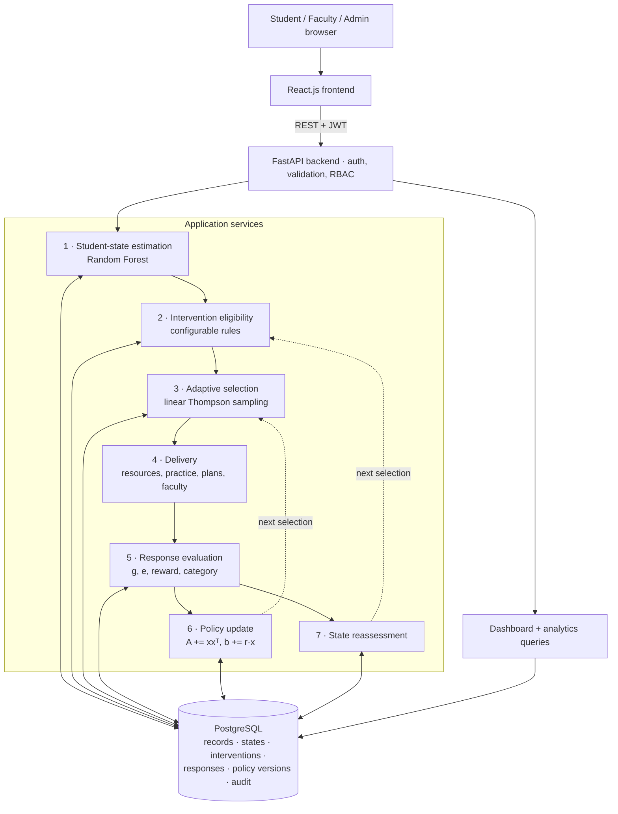

## 8. Database ER Diagram

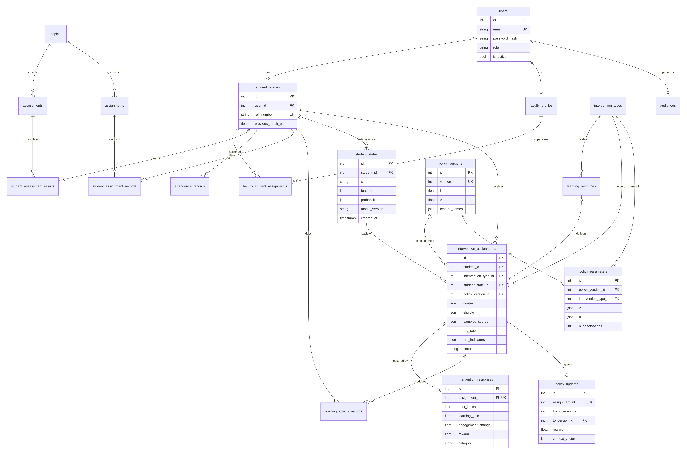

Key columns shown for the central tables; full definitions in `backend/app/models.py`.

Mermaid source

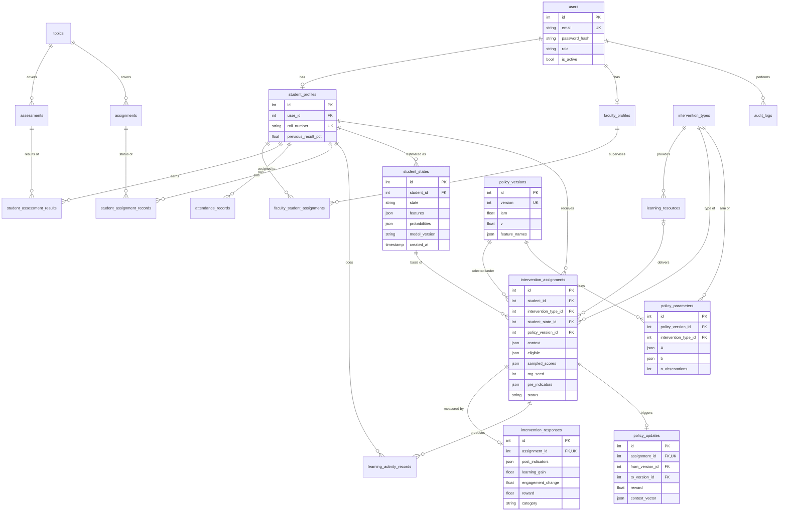

